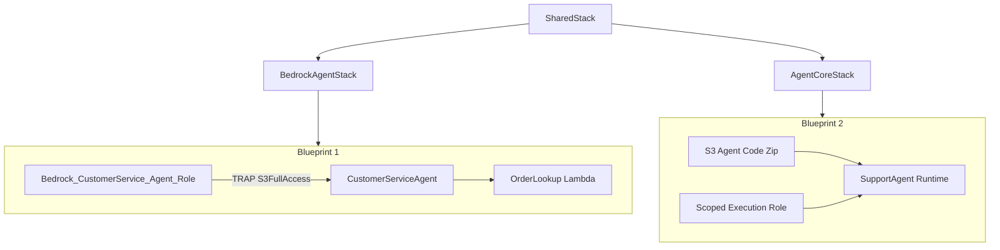

# Milestone 1: Build and Verify AWS Agents

> **Recommended:** use `./scripts/setup-and-deploy.sh` — it prompts for profile, region, and account confirmation. This guide is supplementary detail.

This guide implements **Blueprint 1** (Bedrock Agent) and **Blueprint 2** (AgentCore Runtime) on AWS using CDK TypeScript. SailPoint integration is **Phase 2** — complete agent verification first.

## Prerequisites

- **Dedicated AWS CLI profile** (e.g. `your-demo-profile`) — do **not** reuse shared workshop profiles
- Node.js 20+ (for CDK)
- **No local Docker** — AgentCore uses CDK **direct code deployment** (S3 zip), not containers/ECR
- CDK bootstrap in your target account/region (the setup script can run this for you)
- Bedrock model access enabled in your region for:
  - `us.amazon.nova-lite-v1:0` inference profile (Bedrock Agent)
  - `amazon.nova-lite-v1:0` (AgentCore)

---

## AWS profile setup

Create a project-specific profile. All deploy and verify commands use `AWS_PROFILE` and `AWS_REGION`.

### Step 1 — Authenticate the CLI (recommended: no access keys)

AWS recommends **not** creating long-lived access keys. For local CDK deploy, use one of:

**Option A — `aws login` (preferred)**

If you have AWS CLI v2.27+:

```bash
aws login --profile YOUR_PROFILE
```

Follow the browser prompt and sign in to your **demo AWS account**.

Add to `~/.aws/config`:

```ini
[profile YOUR_PROFILE]
region = us-east-2
output = json
```

**Option B — Access keys (fallback only)**

If `aws login` is unavailable, create CLI access keys in IAM (check the acknowledgment box on the screen you have open), then add to `~/.aws/credentials`:

```ini
[YOUR_PROFILE]
aws_access_key_id = AKIA...YOUR_KEY...
aws_secret_access_key = ...YOUR_SECRET...
```

Do **not** use CloudShell as your primary workflow — AgentCore code deploy and CDK run from your Mac.

### Step 2 — Add profile region to `~/.aws/config` (if not already)

```ini
[profile YOUR_PROFILE]
region = us-east-2
output = json
```

### Step 3 — Verify identity

```bash
aws sts get-caller-identity --profile YOUR_PROFILE
```

Confirm the `Account` matches the demo account you intend to deploy into.

### Step 4 — Bootstrap CDK (once per account/region)

```bash
./scripts/setup-and-deploy.sh
```

Or manually:

```bash
cdk bootstrap aws://YOUR_ACCOUNT_ID/us-east-2 --profile YOUR_PROFILE
```

### Required IAM permissions for deploy principal

Minimum for Milestone 1 (CDK deploy of Bedrock Agent + AgentCore):

- CloudFormation full access (or CDK deploy equivalent)
- IAM role/policy create and attach
- Lambda, S3, Bedrock, Bedrock Agent, Bedrock AgentCore
- `iam:CreateServiceLinkedRole` (AgentCore service-linked roles)

Attach **PowerUser** or a custom deploy policy if deploy fails with `AccessDenied`.

### Alternative auth (not used for this project)

<details>
<summary>SSO or assume-role</summary>

**SSO:**

```ini
[profile YOUR_PROFILE]
sso_start_url = https://YOUR-SSO-PORTAL.awsapps.com/start
sso_region = us-east-2
sso_account_id = YOUR_ACCOUNT_ID
sso_role_name = YourDeployRole
region = us-east-2
output = json
```

**Assume role:**

```ini
[profile YOUR_PROFILE]
role_arn = arn:aws:iam::YOUR_ACCOUNT_ID:role/YourDeployRole
source_profile = your-base-profile
region = us-east-2
output = json
```

</details>

### Cursor agent note

Cursor’s AWS hook may require a separate read-only profile for automated CLI from the IDE. Run CDK deploy from your terminal with your demo profile.

---

## Quick start

```bash
export AWS_PROFILE=YOUR_PROFILE
export AWS_REGION=us-east-2

cd aws-agentic-demo/cdk
npm install
npm run build
npx cdk deploy --all --require-approval never
```

After deploy, run verification:

```bash
../scripts/verify-agents.sh
```

---

## Repository layout (to be created)

```
aws-agentic-demo/
├── cdk/
│   ├── bin/app.ts
│   ├── lib/
│   │   ├── demo-tags.ts
│   │   ├── shared-stack.ts
│   │   ├── bedrock-agent-stack.ts
│   │   └── agentcore-stack.ts
│   ├── agents/agentcore/
│   │   ├── main.py
│   │   └── requirements.txt
│   ├── lambda/order-lookup/
│   │   └── index.py
│   ├── package.json
│   ├── cdk.json
│   └── tsconfig.json
├── scripts/
│   ├── deploy.sh
│   └── verify-agents.sh
└── docs/
    └── milestone-1-build-guide.md
```

---

## Stack architecture



| Stack | Purpose |
|-------|---------|
| `AwsAgenticDemo-Shared` | S3 RAG bucket, sample docs, shared tags |
| `AwsAgenticDemo-BedrockAgent` | Over-privileged IAM role + Bedrock Agent + action group |
| `AwsAgenticDemo-AgentCore` | S3 code bundle + scoped execution role + AgentCore Runtime (no Docker/ECR) |

### AgentCore deploy method (no Docker)

Blueprint 2 uses CDK **`AgentRuntimeArtifact.fromCodeAsset()`** — Python source is zipped and uploaded to S3 automatically during `cdk deploy`. No Dockerfile, no ECR, no local Docker Desktop.

```
cdk/agents/agentcore/
├── main.py           # BedrockAgentCoreApp entrypoint
└── requirements.txt  # bedrock-agentcore, strands-agents, etc.
```

---

## Milestone 1 scope (in)

- Bedrock Agent with Lambda action group (`get_order_status`)
- Intentionally over-privileged `Bedrock_CustomerService_Agent_Role` with `AmazonS3FullAccess`
- AgentCore Runtime via **direct code deployment** (S3 zip via CDK `fromCodeAsset`) — no Docker
- CDK outputs for agent IDs, ARNs, and invoke commands
- `verify-agents.sh` script

## Milestone 1 scope (out — Phase 2)

- SailPoint CIEM connector
- Human access IAM users (`demo-admin`, etc.)
- Knowledge Base vector ingestion (S3 bucket is created; KB can be added next)

---

## Verification checklist

After `cdk deploy --all`:

- [ ] **Bedrock Agent** appears in AWS Console → Bedrock → Agents → `CustomerServiceAgent`
- [ ] Agent alias `live` exists and status is `PREPARED`
- [ ] Test in console: *"What is the status of order 1001?"* → returns `shipped`
- [ ] **IAM role** `Bedrock_CustomerService_Agent_Role` has `AmazonS3FullAccess` attached
- [ ] **AgentCore Runtime** `SupportAgent` shows `READY` in console
- [ ] CLI invoke returns a model response:

```bash
# From stack outputs (set your profile)
export AWS_PROFILE=YOUR_PROFILE
export AWS_REGION=us-east-2

aws bedrock-agent-runtime invoke-agent \
  --agent-id <AgentId> \
  --agent-alias-id <AliasId> \
  --session-id "demo-$(date +%s)" \
  --input-text "What is the status of order 1001?" \
  output.json && cat output.json

aws bedrock-agentcore invoke-agent-runtime \
  --agent-runtime-arn <RuntimeArn> \
  --qualifier DEFAULT \
  --payload '{"prompt":"Hello, who are you?"}' \
  /tmp/agentcore-out.json && cat /tmp/agentcore-out.json
```

---

## Next step

**Switch to Agent mode** in Cursor so the assistant can scaffold all files, run `npm install`, and deploy with your AWS profile.

If deploying manually, ask the assistant to generate each file from this guide in Agent mode.
